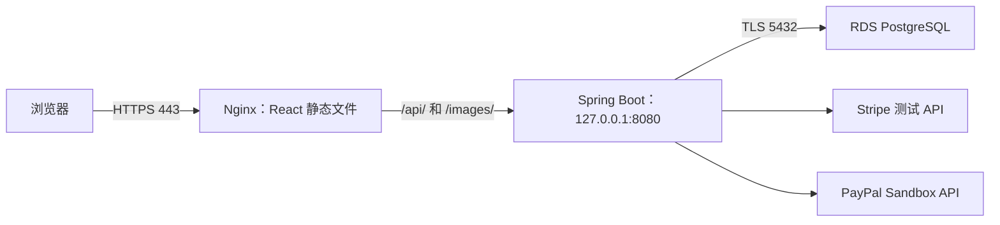

# AWS 部署与维护记录

部署日期：2026-11-05。当前演示地址：https://52.15.49.45 。

这是用于作品集展示的单实例部署，支付使用 Stripe 测试环境和 PayPal Sandbox。

## 架构



Nginx 和 Spring Boot 运行在同一台 EC2 上。RDS 使用同一 VPC 的私网连接，不对公网开放。

| 组件 | 当前配置 |
| --- | --- |
| 区域 | us-east-2（Ohio） |
| EC2 | t3.micro，Amazon Linux 2023，8 GiB 根磁盘 |
| 后端 | Java 17 / Amazon Corretto，systemd 服务 `ecom` |
| 前端 | React / Vite 构建产物，由 Nginx 提供 |
| 数据库 | RDS PostgreSQL，db.t4g.micro，Single-AZ，20 GiB gp2 |
| HTTPS | Let's Encrypt IP 证书，Certbot 定时续期 |
| 数据库备份 | RDS 自动备份，保留 1 天 |

EC2 安全组开放 HTTP 80、HTTPS 443，SSH 22 只允许维护者的公网 IP。RDS 安全组通过 EC2 安全组允许数据库连接；8080 无需对公网开放。

## 文件与配置

| 文件 | 用途 / 服务器位置 |
| --- | --- |
| `ecom.service` | `/etc/systemd/system/ecom.service`，后端开机启动与异常退出后重启 |
| `nginx.conf` | `/etc/nginx/conf.d/ecom.conf`，HTTPS、前端路由与反向代理 |
| `ecom-certbot-renew.service` | 续期证书，成功后重载 Nginx |
| `ecom-certbot-renew.timer` | 每天检查两次，附加最多一小时随机延迟 |
| `configure-server.py` | 首次交互式创建 `~/ecom/app.env` |
| `import-catalog.sql` | 一次性导入分类和商品，并指定线上卖家 |
| `../src/main/resources/application-prod.properties` | 生产环境配置，监听本机并从环境变量读取凭据 |

后端 JAR 位于 `~/ecom/app.jar`，工作目录为 `~/ecom`，商品图片在 `~/ecom/images/`。前端构建产物部署到 `/usr/share/nginx/html/`。

`app.env` 仅文件所有者可读写，由 systemd 加载。数据库密码、JWT 密钥和支付私钥不应提交到仓库或复制进日志。配置脚本使用独占创建，已有配置时不覆盖；维护现有配置时不要删除该文件再重新生成。

后端使用数据库账号 `ecom_app`，通过 RDS CA 文件验证数据库 TLS 证书。生产环境禁用默认演示用户初始化；JWT Cookie 设置 `Secure`、`HttpOnly` 和 `SameSite=Lax`，登录响应不返回 JWT。

管理员创建方式：先公开注册普通账号，再由数据库维护者授予 `ROLE_ADMIN`，之后退出并重新登录。公开注册不接受管理员角色。

## 本次部署过程

1. 创建 EC2，配置 SSH 密钥和安全组，安装 Java 17、Nginx 与 PostgreSQL 客户端。
2. 创建私网 RDS PostgreSQL，建立 `ecommerce` 数据库和 `ecom_app` 应用账号，验证 EC2 到数据库的 TLS 连接。
3. 构建并上传后端 JAR，交互式填写服务端凭据，启用 `ecom.service`。
4. 使用 Certbot 为公网 IP 申请证书，配置 Nginx HTTPS 与 HTTP 跳转，启用续期定时器。
5. 使用线上 API 地址和支付公开凭据构建前端，上传静态文件。
6. 仅导入本地分类、商品及所引用图片，商品归属线上 Seller；不迁移本地用户、密码和订单。
7. 验证接口、图片、登录和权限，并由项目维护者完成两种支付的实际沙盒操作。

`import-catalog.sql` 是一次性导入脚本，不能直接重复执行。导入后推进了 ID 序列，避免新商品与已有商品的 ID 冲突。

## 已验证结果

- HTTPS 首页、前端路由与商品 API 可访问。
- 8 个分类、10 件商品导入成功，归属指定 Seller；9 个不同图片地址均返回成功。两件本地缺少原图的商品使用占位图。
- 线上 API 检查通过：注册、登录、读取当前用户、退出、拒绝 Buyer 访问管理员接口、拒绝公开注册管理员。
- 登录 Cookie 的安全属性已检查；临时 API 检查账号已清理。
- Nginx 配置检查通过，Certbot 模拟续期与重载验证通过。
- 项目维护者反馈 Stripe 测试支付和 PayPal 沙盒支付均成功。这是人工验证结果，不表示已完成真实扣款或线上并发验证。

## 日常维护

以下命令在 SSH 登录 EC2 后执行。

查看后端状态与近期日志：

```bash
systemctl status ecom --no-pager -l
sudo journalctl -u ecom -n 100 --no-pager
```

上传新 JAR 或修改后端环境配置后重启后端：

```bash
sudo systemctl restart ecom
```

修改 Nginx 配置后，检查通过再重载：

```bash
sudo nginx -t && sudo systemctl reload nginx
```

检查证书续期安排与执行结果：

```bash
systemctl list-timers ecom-certbot-renew.timer --no-pager
sudo journalctl -u ecom-certbot-renew.service -n 50 --no-pager
```

## 运行限制

- 关闭本地终端不会停止服务；EC2 的 Stop → Start 通常会更换自动分配的公网 IP。IP 更换后需要更新前后端网址、Nginx 和证书；需要长期稳定入口时再配置固定地址。
- 单 EC2、Single-AZ RDS 不提供跨可用区高可用。商品图片保存在 EC2 磁盘中，不包含在 RDS 备份里。
- 支付确认依赖买家返回页面，当前没有支付 Webhook 补偿流程；取消与退款不在本次部署范围内。
- AWS 资源会持续消耗额度；停止 EC2 不会同时停止 RDS 或消除磁盘费用。免费计划结束或额度耗尽前，需要决定保留、备份或清理资源。
- 尚未设置费用通知，也未完成负载测试或真实支付验证。
